# Posemark

A Typora-style desktop Markdown editor: you write plain Markdown, and the editor renders it in
place — headings look like headings, tables look like tables, and the `#`, `**`, ` ``` `, `$$`
markers only reappear on the line your caret is on.

Built with Electron + CodeMirror 6 + markdown-it + KaTeX + highlight.js + Mermaid.

## Run it

```bash
pnpm install         # once (see the Electron note below for this machine)
pnpm start           # build the renderer bundle, then launch Electron
pnpm dev             # rebuild on change (renderer)
```

Package manager is **pnpm 11** (`packageManager` pinned in `package.json`, build scripts allow-listed
in `pnpm-workspace.yaml`). On this machine pnpm's script gate and Electron's binary download both
needed handling once:

```bash
pnpm approve-builds --all                       # let esbuild run its postinstall
export ELECTRON_SKIP_BINARY_DOWNLOAD=1          # don't let electron's install.js hit the network
pnpm install
```

Then drop the official `electron-v<version>-win32-x64.zip` (from
`https://registry.npmmirror.com/-/binary/electron/<version>/`) into
`node_modules/.pnpm/electron@<version>/node_modules/electron/dist/` and write `electron.exe` into
`path.txt` next to it. `pnpm exec electron --version` should echo the version you placed.

## Test and release

```bash
pnpm test            # unit tests (node:test): Markdown renderer, path helpers, outline, word count, drafts, user themes
pnpm dist            # package an installer for the current OS into release/
```

CI runs the tests and the renderer build on Linux, Windows and macOS for every push and pull
request. To publish a release, bump `version` in `package.json`, commit, then push a matching tag:

```bash
git tag v0.1.0 && git push origin v0.1.0
```

The release workflow builds the Windows (NSIS installer + portable zip), macOS (dmg, x64 + arm64) and Linux (AppImage, deb)
packages and attaches them to a GitHub Release. Builds are not code-signed yet.

Running Electron **45.0.0** (Chromium 156, Node 22).

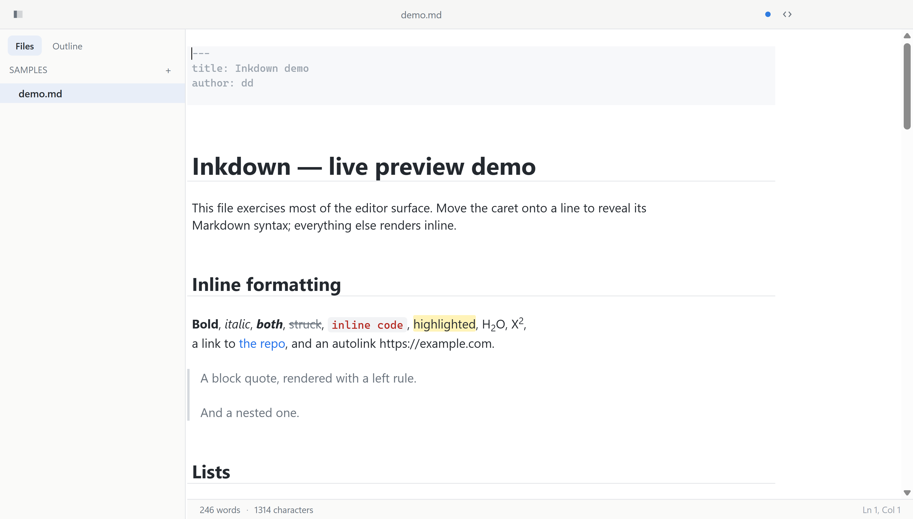

In-place table editing — click a table and you get the grid, not pipes:

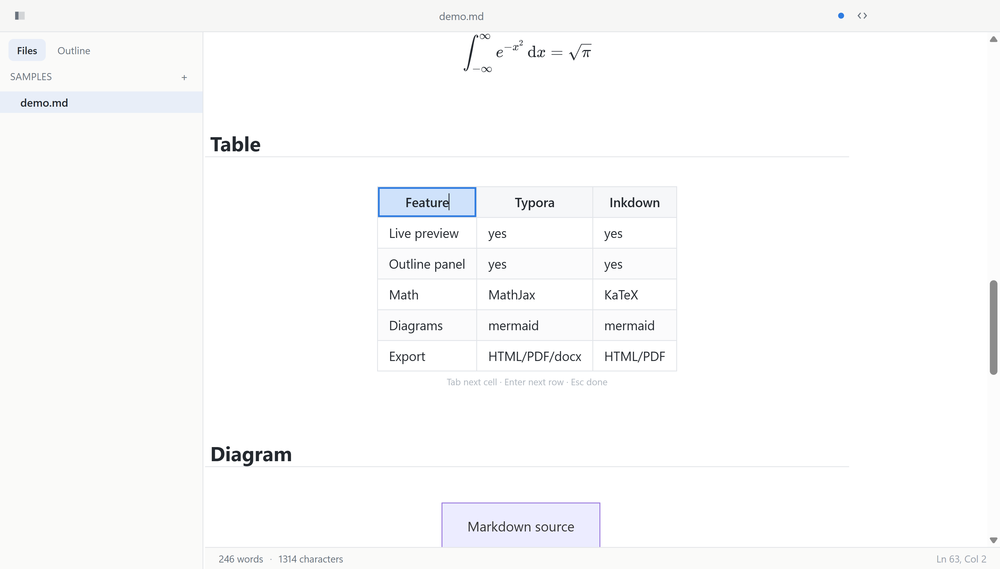

Rows, columns and alignment from a right-click menu on any cell:

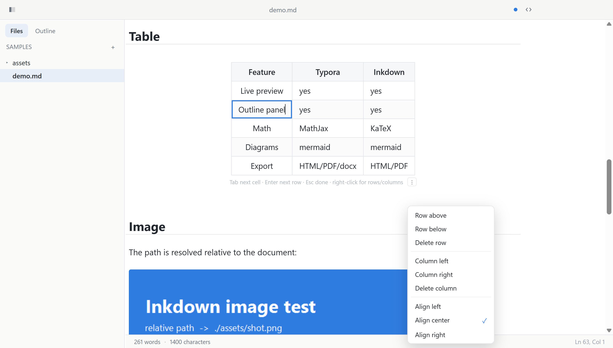

Cells render their inline Markdown until you focus them:

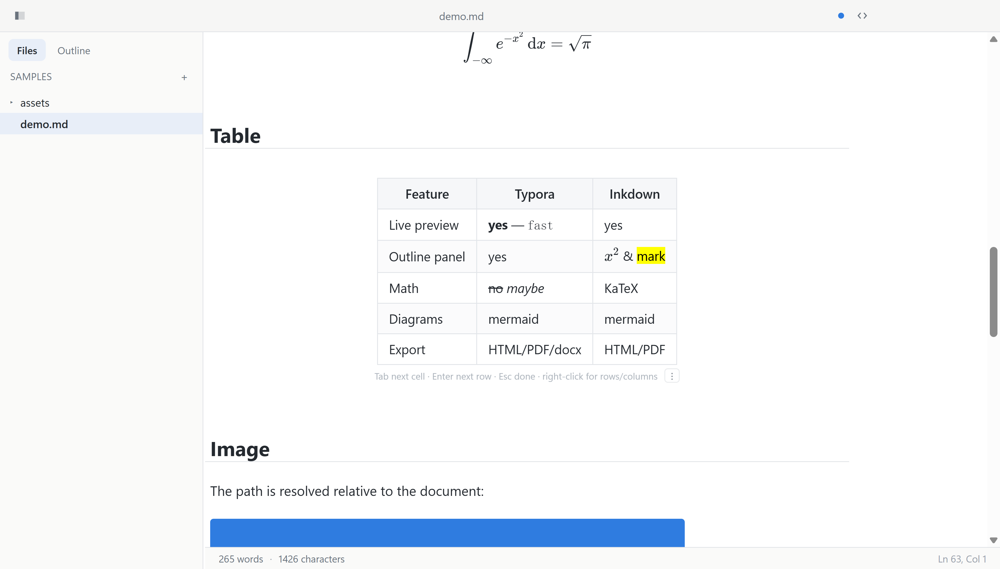

Code block while editing: fences stay visible, the code stays highlighted:

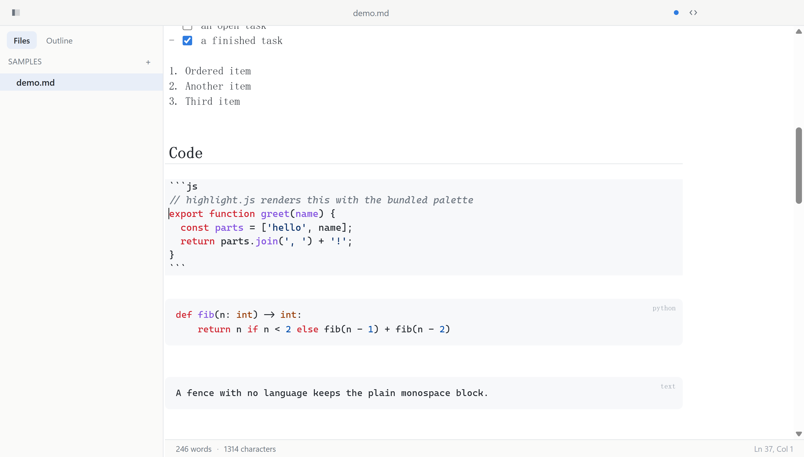

Math and diagram blocks while editing — the formula is a field with its render below, the diagram
keeps its source and re-renders underneath:

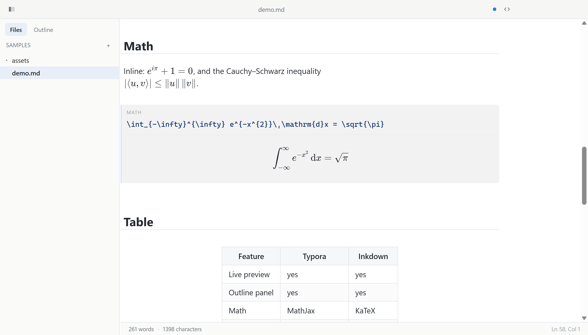

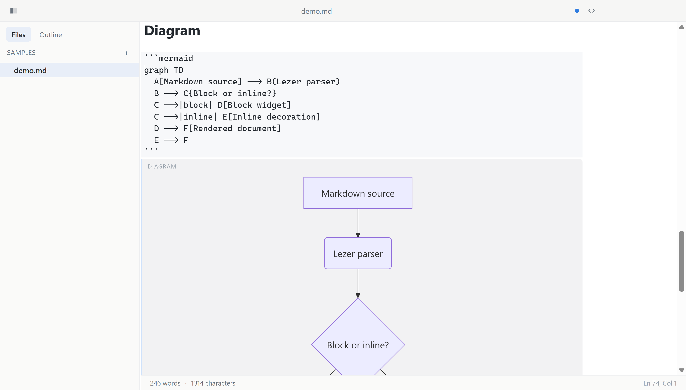

Images too — the picture appears under the `` line you are editing:

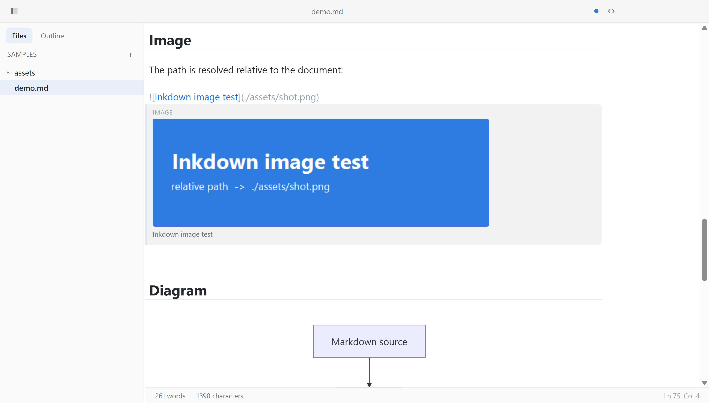

Dropping an image file onto the editor:

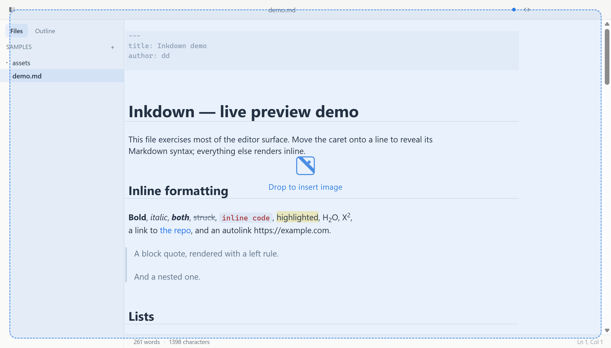

Click an image to get a resize frame (`` is what ends up in the file):

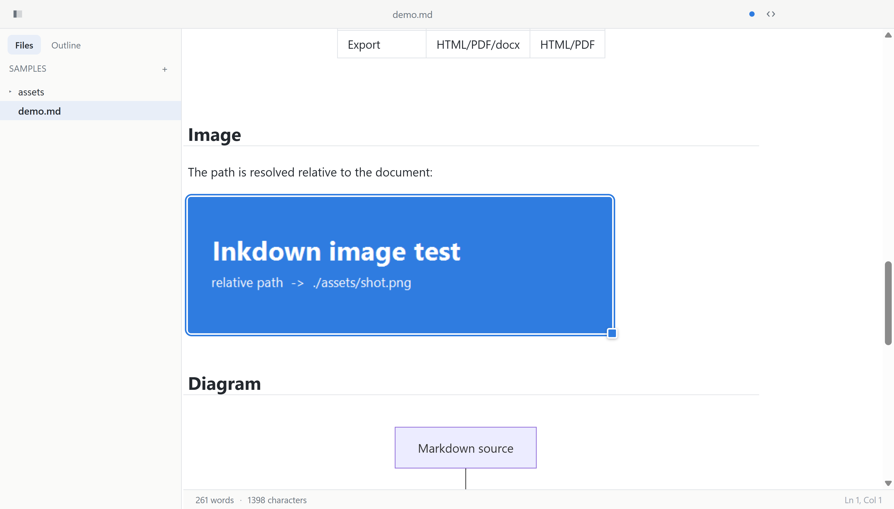

`[TOC]` on its own line becomes a clickable contents block; `[^ref]` footnotes render as superscript
numbers with their definitions collected at the end:

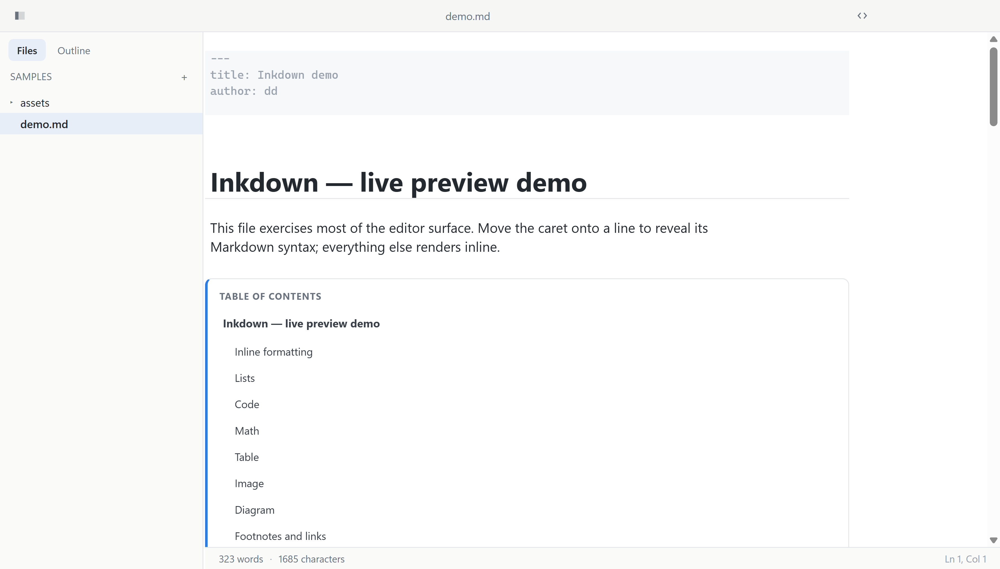

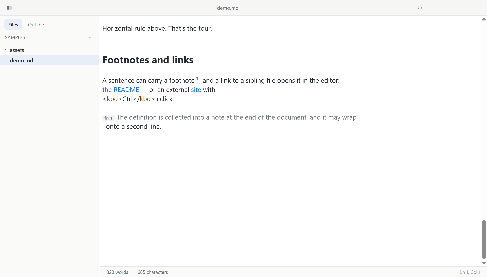

Right-click anything in the file tree for new file / new folder / rename / trash:

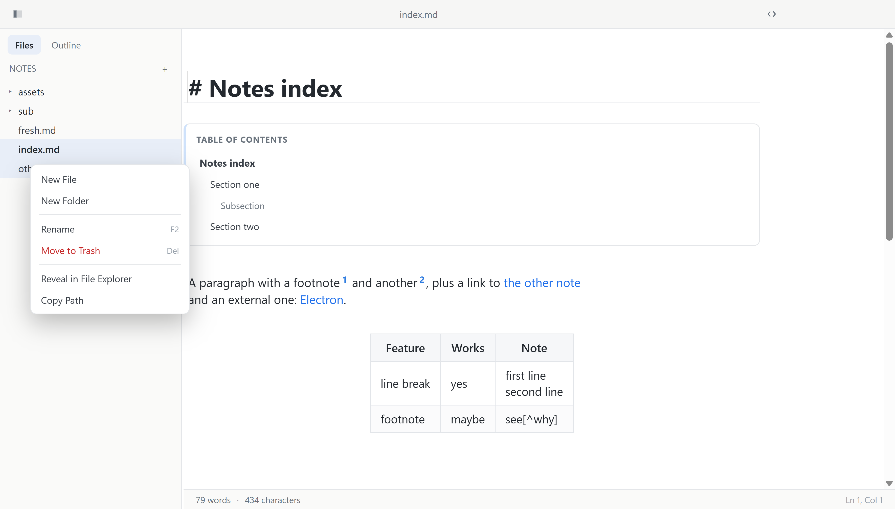

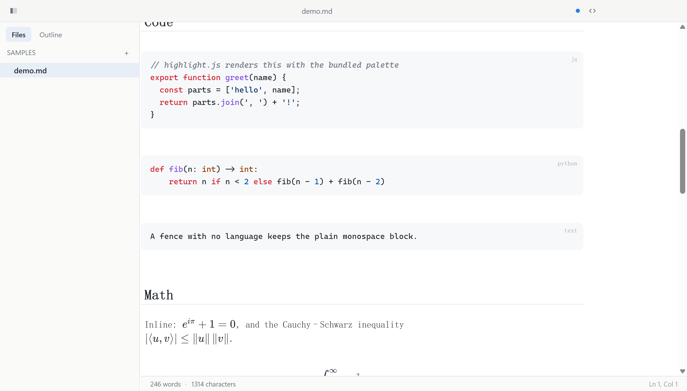

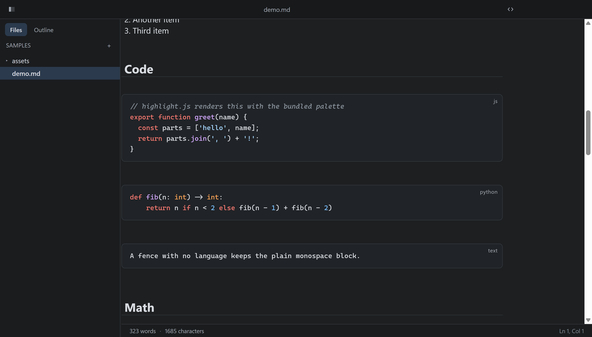

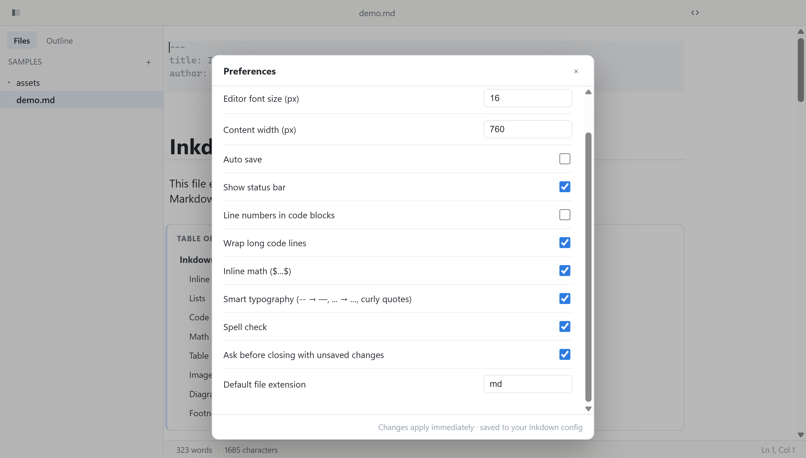

## What works

**Editing (live preview)**

- ATX / setext headings with per-level typography, horizontal rules, quotes, bullet/ordered lists
- Bold, italic, strikethrough, `==highlight==`, `H~2~O`, `X^2^`, inline code, links (bracket + URL hidden)
- Reference-style links: `[text][label]` and bare `[label]` render as links once a `[label]: url` line
  exists; the definition lines are dimmed, and `Ctrl`+click follows them like any other link
- **Emoji shortcodes**: `:smile:` renders as 😄 (GitHub names); typing `:` plus a few letters pops up an
  autocomplete list
- **GitHub-style alerts**: a quote starting with `> [!NOTE]`, `[!TIP]`, `[!IMPORTANT]`, `[!WARNING]` or
  `[!CAUTION]` gets an icon, a label and a coloured bar, in the editor and in every export
  (`Paragraph › Alert` wraps the selection)
- **Strict mode** switch (Preferences › Markdown): off, `#Title` without the space still counts as a
  heading, like Typora; **preserve single line breaks** carries the editor's line breaks into exports
- Task lists with clickable checkboxes (`- [ ]` / `- [x]`)
- Fenced code blocks rendered with highlight.js, optional line numbers and soft wrap
- Putting the caret inside a fence un-renders it to source **with the code still syntax-highlighted**
  (JS/TS, Python, JSON via CodeMirror's language parsers; everything else falls back to our palette)
- GFM tables rendered as real tables that **open as an editable grid when you click or put the caret in them**:
  type into a cell, `Tab` / `Shift-Tab` walks the cells, `Enter` jumps down a row, `Tab` on the last cell
  appends a row, `Esc` drops the caret out below the table. Every keystroke is written back to the
  Markdown source (pipes escaped), and `Ctrl+Z` inside a cell undoes the edit. Right-click any cell
  (or hit the `⋮` at the end of the hint line) for rows/columns: insert row above/below, delete row,
  insert column left/right, delete column, and left/center/right alignment — each one rewrites the
  Markdown, delimiter row included. Cells show their inline Markdown rendered (`**bold**`, `` `code` ``,
  `$x^2$`, `==mark==`) while you are not typing in them, and the raw source the moment a cell takes
  focus.
- Inline `$…$` and block `$$…$$` math via KaTeX — a `$$` block opens as a **math field**: the TeX in a
  monospace input, the formula rendered below a dashed rule, updated on every keystroke. `Esc` or
  `Ctrl/Cmd+Enter` leaves the field and drops the caret after the block.
- ` ```mermaid ` blocks rendered as diagrams — same deal while editing: source on top, the diagram
  re-renders below after a short pause, and a syntax error shows up in the preview instead of
  replacing your text
- Relative image paths resolved against the current document; the picture renders inline, and while
  you edit its `` line the image shows underneath the source (with its alt text as caption,
  and a `missing: …` panel when the path does not resolve)
- **Drop an image file onto the editor** and it is copied into `assets/` next to the document (unique
  name if it already exists) with `` inserted at the drop point; with no file
  open it goes to `Pictures/posemark`. A dashed overlay shows the drop zone while you drag.
- **Click an image to resize it**: a frame + corner handle appear, dragging scales it with the aspect
  ratio locked, and the width is written into the Markdown as ``. Hold **Shift**
  while dragging to unlock the ratio — that writes `` (both attributes land in
  the exported ``). Double-click the image to jump into its `` source instead.
- YAML front matter kept visible but visually de-emphasised
- Source code mode (`Ctrl+/`) shows the raw Markdown in a monospace font with syntax highlighting:
  headings sized by level, code fences and front matter shaded, quotes with their bar, inline code,
  links, task markers and all the markers greyed
- **Links work**: clicking a rendered link (or `Ctrl`+click on one in the source) opens `http(s)`/`mailto`
  in the system browser, a relative `.md` in the editor (jumping to `#anchor` if there is one), any
  other relative file in its default app, and `#foo` scrolls to that heading
- **`[TOC]`** becomes a contents block built from the headings below it; clicking an entry jumps there
  (with `## Title {#custom-id}` respected for anchors, in the block and in the exported HTML)
- **Footnotes**: `[^label]` renders as a superscript number that jumps to its definition, and
  `[^label]: text` lines are dimmed with a `fn n` badge — the export collects them into a
  `<section class="footnotes">` with back-links
- **Paste a screenshot** (`Ctrl+V` with an image on the clipboard) and it lands in `assets/` and is
  inserted, same as the file drop
- **Smart typography** while typing: `--` → —, `...` → …, straight quotes → curly quotes, skipped
  inside code and at the start of a line (so `---` still makes a rule). Toggle off in Preferences.
- **Auto pair**: `(`, `[`, `{` (and quotes while smart typography is off) close themselves, typing the
  closer steps over it, Backspace removes an empty pair. The Markdown markers pair too: `*`, `_`, `` ` ``
  and `$` close themselves (`**` gives `**|**`), and typing `*`, `_`, `~`, `=`, `^`, `` ` `` or `$` with a
  selection wraps it. Both halves can be switched off in Preferences › Editor.
- **Smart paste**: rich text on the clipboard (a web page, Word, Google Docs, another editor) is
  converted to Markdown on `Ctrl+V` (headings, lists, tables, code, links, images, alerts…). Copies from
  code editors are detected and pasted as-is; `Ctrl+Shift+V` always pastes the plain text.
- `Shift+Enter` inside a table cell inserts `<br>` instead of ending the cell

**Workspace**

- Open file / open folder, file tree with expand-collapse, quick open (`Ctrl+P`), recent files
- **File tree sorting and filters** (the `⋯` button or the sidebar's right-click menu): natural / name /
  modified / created order, ascending or descending, show hidden files, show all file types (other
  files open in their default app)
- **The folder is watched**: files created, renamed or removed outside the app show up in the tree,
  and if the open document is rewritten on disk it is reloaded in place (unless you have unsaved edits,
  in which case you get a notice instead)
- **Search in folder** (`Ctrl+Shift+F`, the Search tab): matches grouped by file with the line number,
  case / whole word / regex toggles; clicking a hit opens the file and selects the match
- **File tree operations**: right-click a row (or the sidebar background) for New File, New Folder,
  Rename (`F2`), Move to Trash (`Del`, goes to the recycle bin), Reveal in File Explorer, Copy Path.
  Renaming is inline, keeps the extension, refuses to overwrite, and follows the open document
- **Drag and drop in the file tree** moves a file or folder into another folder (never
  overwrites); **Duplicate** (`Ctrl+D`) makes `name copy.md`; **Undo Last File Operation**
  (`Ctrl+Z` with the tree focused, or the right-click menu) reverses the last rename, move,
  duplicate or new file; arrow keys / `Enter` / `Home` / `End` walk the tree, `→` / `←` expand
  and collapse folders
- **File list mode** (the `☰` button, `Ctrl+Shift+4`, or Preferences › Appearance › Sidebar):
  every note under the folder in one flat list, newest first, with its subfolder and date
- **Pinned folders**: pin the open folder from the `⋯` menu and it stays at the top of
  `File › Open Recent` and of Quick Open (`Ctrl+P`, which also lists recent files from outside the
  folder). Preferences › General can stop recording recent files and folders altogether.
- **Outline panel**: headings nest and collapse (the fold state is remembered per file), a filter
  box narrows the list with the matches highlighted, the `☰` button flattens it, and the heading
  the caret is under is marked and kept in view
- Find / replace (`Ctrl+F`, `Ctrl+H`) with regex / case / whole-word, jump to line (`Ctrl+G`)
- **Word count**: the status bar shows words and characters (plus "n words selected"); click it or
  press `Ctrl+Shift+W` for the panel with characters with/without spaces, lines, paragraphs and
  reading time (speed configurable in Preferences), for the document and for the selection
- Auto save, dirty indicator, save-on-open-another prompt
- **Unsaved-draft backup**: a dirty document is mirrored into the app's `drafts/` folder a moment
  after every edit and dropped once saved, so a crash or a forced shutdown loses nothing;
  `File › Recover Unsaved Drafts…` (also Preferences › General) lists what was left behind with a
  preview, and restores it into the window or discards it
- **Multiple windows**: `Ctrl+Shift+N` opens another window (one document per window, like
  Typora), `Ctrl+Tab` / `Ctrl+Shift+Tab` cycle through them, the Window menu lists them, and a
  second launch with a file opens it in a new window. `Ctrl+Shift+T` reopens the last closed file.
- **Launch behaviour** (Preferences › General › Startup): start with a new document, restore the
  last folder, restore the last file and folder, or always open a fixed folder
- Focus mode, typewriter mode, zoom, fullscreen, always on top

**Output**

- Export HTML (self-contained: theme CSS + KaTeX markup + rendered diagrams inlined)
- Export PDF (rendered through a hidden window and Chromium `printToPDF`, so it matches the page)
- Copy as HTML, copy as Markdown
- **Copy for WeChat** (`Ctrl+Alt+C`, also in the editor's right-click menu) — see below

### Copy for WeChat

公众号 throws away every stylesheet, so a normal rich copy arrives as unstyled text. This command
rebuilds the document with **inline styles only** and puts it on the clipboard as a `text/html`
flavour (the plain-text flavour carries the Markdown source, for pasting into a plain editor).

- Every element gets a `style` attribute from a small WeChat-safe profile, coloured from the theme
  you are looking at; no `class`, no `id`, no `<style>`, no `href`.
- The style is configurable in **Preferences › Export** (also `File › Export › Export Settings…`),
  next to a **live preview** that runs the real copy pipeline on the open document (or a built-in
  sample) inside a stylesheet-free frame, at phone or desktop width: colour theme cards (follow the
  editor, or any light theme — dark ones fall back to Default), accent colour, H2 style (bar /
  underline / badge / plain), font size, line height, letter and paragraph spacing, justified text,
  first-line indent, code language labels, and the 参考链接 list.
- Code blocks keep their highlight colours as inline `color`s on `<span>`s.
- Tables are rebuilt with visible borders, a shaded header row and padding on every cell.
- Local images are embedded as `data:` URIs (WeChat cannot read `file://`); remote ones are left alone.
- **Formula blocks and mermaid diagrams are rasterised to PNG** — the 公众号 editor would show raw
  KaTeX spans and drop the `<svg>`. They are drawn once in an offscreen window and pinned to their
  CSS size, so an inline formula stays inline-sized.
- Links cannot be clicked inside 公众号, so each one keeps its text and gains a superscript number,
  with a 参考链接 list of the real URLs at the end.

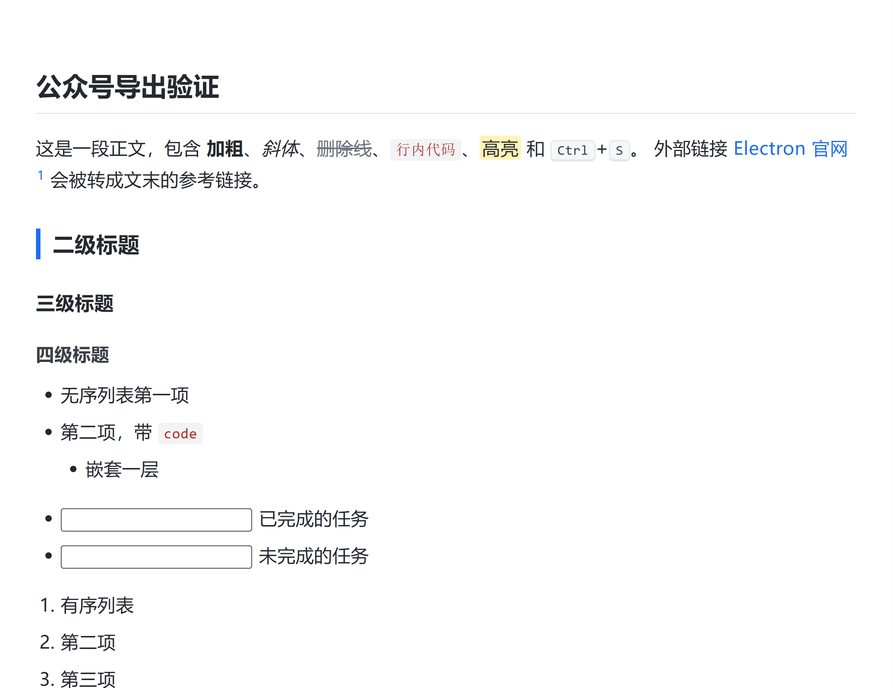

What you see above is the pasted result rendered with **every stylesheet stripped** — exactly the
worst case the editor can do to it.

Caveats: 公众号 strips `border-radius` on some elements and rewrites `<table>` widths; wide code
blocks rely on `overflow-x: auto`, which the app-side editor honours but the phone-side preview may
scroll less gracefully. Nothing that needs remote hosting (image uploads, 图床) is attempted.

**Themes**: Default, Night, Pixyll, Whitey, Newsprint — plain CSS variable files, drop your own in
`src/renderer/styles/themes/`.

- **Follow the system dark mode** (Preferences › Appearance): pick one theme for light and one for
  dark and the editor switches with the OS; the Themes menu then changes whichever slot is active.
- **Custom CSS** without touching the app: `Themes › Open Theme Folder` (or the button in
  Preferences) opens the user theme folder, Typora-style. `base.user.css` is appended to every
  theme, `<theme>.user.css` to that theme, and a whole `<name>.css` shows up in the Themes menu as
  a theme of its own (start it with `/* dark */` to mark it dark). Exports pick the overrides up
  too. Edits apply when the theme is re-selected or the window is reloaded.

## Verifying without clicking

The main process has three verification modes (they are dev-only flags, not user features):

```bash
# render samples/demo.md once and save a screenshot
pnpm exec electron . samples/demo.md --screenshot=tmp/shot.png --wait=4000

# run every editor command and print the resulting document
pnpm exec electron . samples/demo.md --selftest

# build the exported HTML + PDF through the real pipeline
pnpm exec electron . samples/demo.md --export-test=tmp/exp

# build the WeChat fragment, render it with every stylesheet stripped, audit the computed
# styles, and print what actually landed on the clipboard
pnpm exec electron . samples/demo.md --wx-test=tmp/wx
```

`POSEMARK_DEBUG=1` forwards renderer console output to the terminal, `POSEMARK_DUMP=1|2|3` dumps the
syntax tree / visible line texts / block widgets, and `POSEMARK_SCROLL=<px>` scrolls before the capture.
`POSEMARK_JS=<script>` runs renderer code before the capture and `POSEMARK_TYPE=<text>` types real
keystrokes into the editor (that is how the smart-typography input handler is verified).

## Layout

```
src/main/        main process: windows, menu, IPC, config store, PDF pipeline
src/main/menu.js application menu (the Typora-like menu tree)
src/main/drafts.js      unsaved-draft backups under userData/drafts
src/main/user-themes.js user theme folder (base.user.css, <theme>.user.css, whole themes)
src/renderer/    renderer bundle
  main.js        app shell: files, sidebar, outline, status bar, command dispatch, export
  editor.js      CodeMirror 6 setup + paragraph/format commands
  live-preview.js decorations: hide marks off-caret, replace blocks with widgets
  blocks.js      block scanner + block widgets (code, table, math, diagram, image, task)
  markdown.js    markdown-it instance for export / copy-as-HTML / table rendering
  wechat.js      copy-for-WeChat: inline style profile + rasteriser for maths and diagrams
  syntax.js      highlight.js wrapper
  paths.js       relative-path → file:// resolution
  outline.js     outline tree / filter / current-heading helpers
  wordcount.js   word count panel figures and reading time
  styles/        app.css, editor.css, content.css (export), themes/*.css
samples/demo.md  a document that exercises everything
docs/            screenshots
```

## Keyboard shortcuts

| Action | Keys |
| --- | --- |
| New / Open / Save / Save As | `Ctrl+N` / `Ctrl+O` / `Ctrl+S` / `Ctrl+Shift+S` |
| New window / Next, previous window / Reopen closed file | `Ctrl+Shift+N` / `Ctrl+Tab`, `Ctrl+Shift+Tab` / `Ctrl+Shift+T` |
| Quick open | `Ctrl+P` |
| Find / Replace | `Ctrl+F` / `Ctrl+H` |
| Source code mode | `Ctrl+/` |
| Focus mode / Typewriter mode | `F8` / `F9` |
| Heading 1–6 / Paragraph | `Ctrl+1…6` / `Ctrl+0` |
| Bold / Italic / Code / Strike / Highlight | `Ctrl+B` / `Ctrl+I` / `Ctrl+Shift+\`` / `Alt+Shift+5` / `Ctrl+Shift+H` |
| Insert link / image | `Ctrl+K` / `Ctrl+Shift+I` |
| Table / Code fence / Math block | `Ctrl+T` / — / `Ctrl+Shift+M` |
| Sidebar / Outline / Search / Files / File list | `Ctrl+Shift+L` / `Ctrl+Shift+1` / `Ctrl+Shift+2` / `Ctrl+Shift+3` / `Ctrl+Shift+4` |
| Word count panel | `Ctrl+Shift+W` |
| Find in folder / Paste as plain text | `Ctrl+Shift+F` / `Ctrl+Shift+V` |
| Export PDF / Print | `Ctrl+P` |
| Copy for WeChat | `Ctrl+Alt+C` |
| Rename / Duplicate / Move to trash / Undo file operation (file tree) | `F2` / `Ctrl+D` / `Del` / `Ctrl+Z` |

## Not implemented (and why it shows)

- Editing the *inside* of a rendered formula (picking a sub-expression in the KaTeX tree) — the field
  is whole-TeX, not structural. Tables, code, mermaid and images are all editable in place now.
- Pandoc export (docx / EPUB / LaTeX), image uploaders, spell-check dictionaries beyond Chromium's.
- Math auto-numbering and `\label`/`\ref`; `sequence` / `flow` diagram languages (only Mermaid).
- Strict mode only relaxes headings; list indentation still follows GFM.
- Tabs: one document per window, like Typora (`Ctrl+Tab` switches windows instead).
