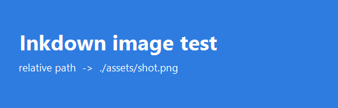
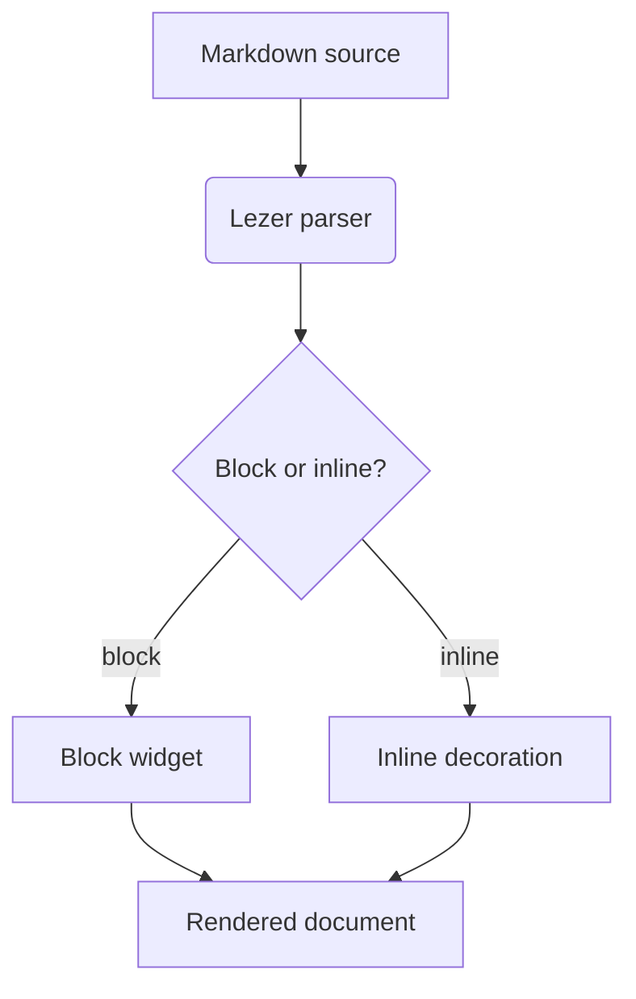

# Posemark — live preview demo

This file exercises most of the editor surface. Move the caret onto a line to reveal its
Markdown syntax; everything else renders inline.

[toc]


## Inline formatting

**Bold**, *italic*, ***both***, ~~struck~~, `inline code`, ==highlighted==, H~2~O, X^2^,
a link to [the repo](https://github.com/), and an autolink https://example.com.

> A block quote, rendered with a left rule.
>
> > And a nested one.

## Lists

- First bullet
- Second bullet with a nested list
  - nested item
  - another one
- [ ] an open task
- [x] a finished task

1. Ordered item
2. Another item
3. Third item

## Code

```js
// highlight.js renders this with the bundled palette
export function greet(name) {
  const parts = ['hello', name];
  return parts.join(', ') + '!';
}
```

```python
def fib(n: int) -> int:
    return n if n < 2 else fib(n - 1) + fib(n - 2)
```

```text
A fence with no language keeps the plain monospace block.
```

## Math

Inline: $e^{i\pi} + 1 = 0$, and the Cauchy–Schwarz inequality
$|\langle u, v \rangle| \le \|u\|\,\|v\|$.

$$
\int_{-\infty}^{\infty} e^{-x^{2}}\,\mathrm{d}x = \sqrt{\pi}
$$

## Table

| Feature | Typora | Posemark |
| --- | --- | --- |
| Live preview | yes | yes |
| Outline panel | yes | yes |
| Math | MathJax | KaTeX |
| Diagrams | mermaid | mermaid |
| Export | HTML/PDF/docx | HTML/PDF |

## Image

The path is resolved relative to the document:



## Diagram



---

Horizontal rule above. That's the tour.

## Footnotes and links

A sentence can carry a footnote[^why], and a link to a sibling file opens it in the editor:
[the README](../README.md) — or an external [site](https://www.electronjs.org/) with
<kbd>Ctrl</kbd>+click.

[^why]: The definition is collected into a note at the end of the document, and it may wrap
  onto a second line.
