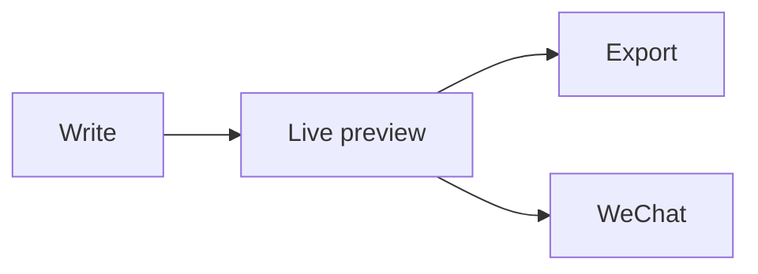

# Posemark 0.1 release notes

A **live-preview** Markdown editor: you type plain text and read a typeset document. The `#` and `**` markers only show up on the line your caret is on.

> [!TIP]
> Press `Ctrl+/` to switch to source code mode at any time, and again to come back.

## Highlights

- [x] Export to HTML, PDF and one long image; PDFs get headers, footers and page numbers
- [x] Copy for WeChat in one click — formulas and diagrams become images
- [x] Chinese and English interface, follows the system dark mode
- [ ] Plugin gallery (planned)

| Feature | Shortcut | What it does |
| --- | --- | --- |
| Source code mode | `Ctrl+/` | Show the raw Markdown |
| Focus mode | `F8` | Dim everything but the current paragraph |
| Quick open | `Ctrl+P` | Jump to a file by name |

## Math

Inline math $e^{i\pi} + 1 = 0$, or a display equation:

$$
\sum_{k=1}^{n} k^2 = \frac{n(n+1)(2n+1)}{6}
$$

## Diagram



## Code

```ts
export function greet(name: string): string {
  return `Hello, ${name}!`;
}
```
