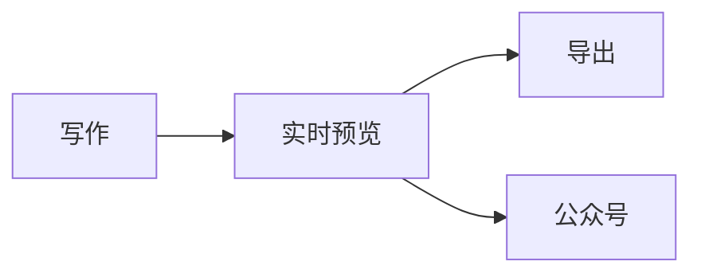

# Posemark 0.1 发布说明

一款**所见即所得**的 Markdown 编辑器：写的是纯文本，看到的是排好版的文档。光标移到哪一行，那一行才露出 `#`、`**` 这些标记。

> [!TIP]
> 按 `Ctrl+/` 随时切换到源代码模式，再按一次回到实时预览。

## 本版亮点

- [x] 导出 HTML、PDF、长图，PDF 支持页眉页脚和页码
- [x] 一键复制到微信公众号，公式和图表自动转成图片
- [x] 中文界面，跟随系统深色模式
- [ ] 插件市场（规划中）

| 功能 | 快捷键 | 说明 |
| --- | --- | --- |
| 源代码模式 | `Ctrl+/` | 查看原始 Markdown |
| 专注模式 | `F8` | 淡化当前段落以外的内容 |
| 快速打开 | `Ctrl+P` | 按文件名跳转 |

## 公式

行内公式 $e^{i\pi} + 1 = 0$，也可以写独立公式：

$$
\sum_{k=1}^{n} k^2 = \frac{n(n+1)(2n+1)}{6}
$$

## 流程图



## 代码

```ts
export function greet(name: string): string {
  return `你好，${name}！`;
}
```
